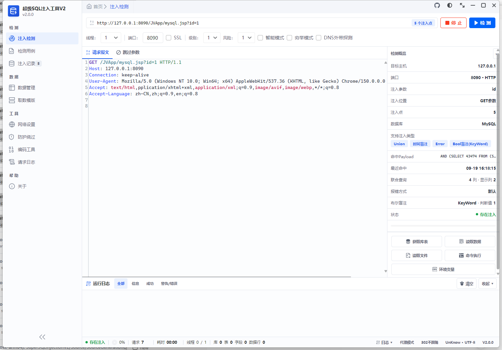
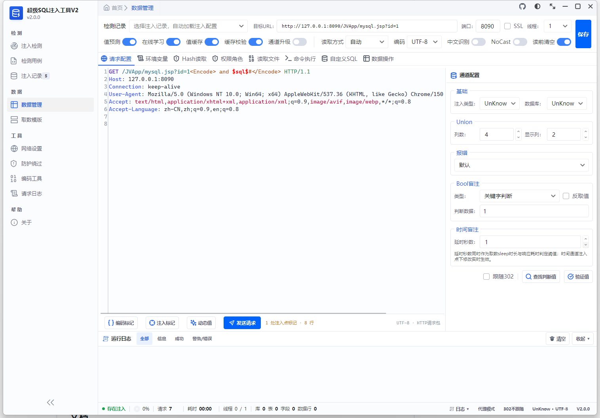
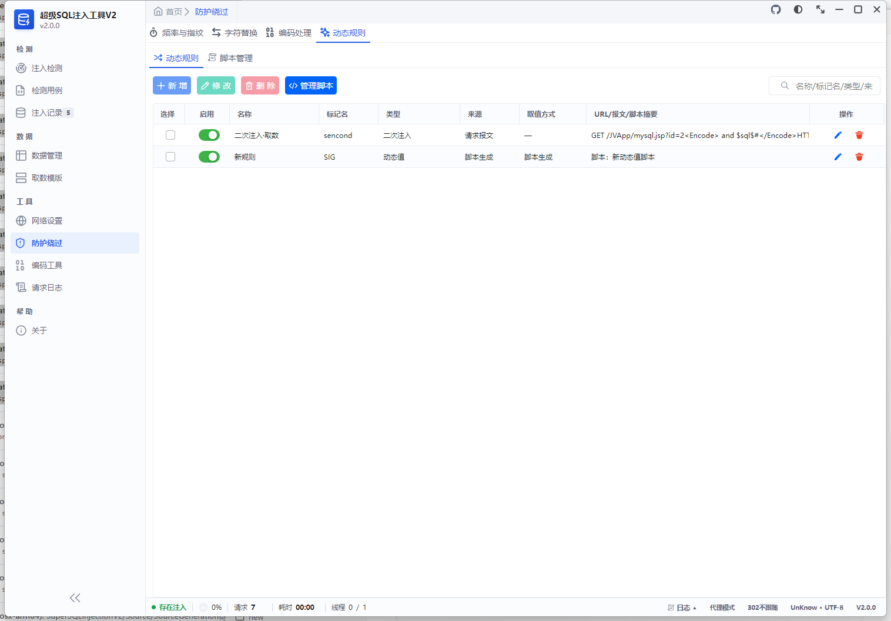
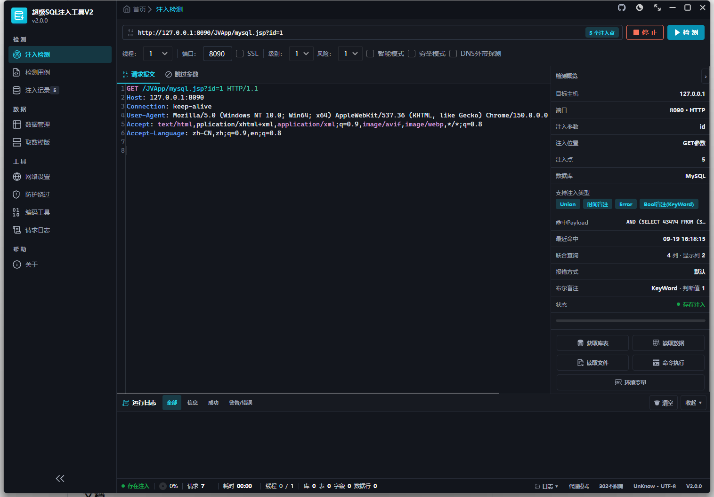

# SuperSQLInjectionV2（超级 SQL 注入工具 V2）

跨平台 SQL 注入检测与利用工具，是 [SuperSQLInjectionV1](https://github.com/shack2/SuperSQLInjectionV1) 的全面重构升级：从 Windows WinForms 迁移到 **Avalonia 12 跨平台桌面端**，并新增 **Native AOT 命令行版本**，支持 Windows / Linux / macOS。

> ⚠️ **免责声明**：本工具仅用于已获授权的安全测试与教学研究。使用本工具对未授权目标进行探测所产生的一切后果由使用者自行承担，与作者无关。

## 界面预览

| 注入检测（浅色） | 数据管理（浅色） |
| --- | --- |
|  |  |

| 防护绕过 · 动态规则（浅色） | 注入检测（暗色主题） |
| --- | --- |
|  |  |

## 功能特性

### 注入检测

- 全类型检测 Payload：Union 联合查询、报错注入、Bool 盲注、时间盲注、DNS 外带、堆叠注入
- level / risk 级别配置，内置分级 Payload 库覆盖主流检测场景
- 盲注网页相似度对比识别（页面差异 + 相似度双通道判定）
- 智能模式、跳过参数、多注入点标记（GET / POST / Cookie / Header 等任意位置）
- 检测到注入后自动标注注入点位置、注入类型、数据库类型，并生成结构化注入记录

### 数据获取

- 支持 14 种数据库：MySQL、SQLServer、PostgreSQL、Oracle、DB2、SQLite、Access、Informix、DM（达梦）、Kingbase（人大金仓）、OpenGauss、H2、HSQLDB、ClickHouse
- 库 / 表 / 字段结构遍历与数据读取，值预测、在线学习、结果缓存与校验
- 取数模版可视化编辑（按数据库类型管理 payload 模板，保存热生效）
- 环境变量读取、自定义 SQL 执行、Hash 读取

### 注入利用

- 命令执行：SQLServer xp_cmdshell / Ole Automation、MySQL UDF（内嵌 lib_mysqludf_sys 二进制，Union 写库到 plugin 目录 + create function sys_eval）、PostgreSQL UDF（8.2~9.4）与 COPY FROM PROGRAM、Oracle Java 存储过程等
- 文件读写：load_file / into outfile、xp_cmdshell 写文件、PostgreSQL large object / COPY 等方式
- 权限角色枚举（当前用户、DBA 判断、角色成员）

### 防护绕过

- Tamper 脚本（内置 QuickJS 引擎，自定义 payload 绕过脚本）
- 字符替换规则、编码处理（URL/Unicode/Base64/HEX 等链式编码标记）
- 协议级绕过：HPP 参数污染、参数名大小写混淆、chunked 分块发包
- 随机源 IP（XFF 等头部）、随机 UA 池、HTTP 代理、请求频率控制
- 动态规则：前置动态值（HTTP 请求抓取 / 自定义脚本生成，支持 API 签名场景）+ 后置二次注入，报文中以 `<DRule>标记名</DRule>` 标记联动

### 工程化

- 注入记录管理：检测结果结构化保存，一键恢复注入点配置继续利用
- HTTP 报文语法高亮编辑器（AvaloniaEdit）、编码工具箱、完整请求日志
- 明暗双主题 UI、软件更新检测（SoftUpdate）
- 命令行版与桌面版共享核心引擎，支持脚本化批量检测

## 运行形态

| 形态 | 项目 | 说明 |
| --- | --- | --- |
| 桌面端 GUI | `SuperSQLInjectionV2.Desktop` | Avalonia 12 + Semi/Ursa 主题，Windows / Linux / macOS |
| 命令行 CLI | `SuperSQLInjectionV2.Cmd` | Native AOT 单文件，适合自动化与集成 |
| Kimi Work 技能包 | `skills/supersqlinjectionv2-cmd` | 内置 CLI 的 AI 助手技能（SKILL.md + 参考文档） |

## 构建

### 环境要求

- [.NET 10 SDK](https://dotnet.microsoft.com/download)
- Native AOT 编译依赖：
  - **Windows**：Visual Studio 2022+（MSVC C++ 生成工具）
  - **Linux**：`sudo apt install clang zlib1g-dev`
  - **macOS**：Xcode 命令行工具（`xcode-select --install`），Apple Silicon

### 普通编译（开发调试）

```bash
dotnet build SuperSQLInjectionV2.sln
# 或仅编译桌面端
dotnet build SuperSQLInjectionV2.Desktop/SuperSQLInjectionV2.Desktop.csproj
```

### Native AOT 发布（本机脚本，位于 `dev/` 目录）

| 脚本 | 平台 | 产物 |
| --- | --- | --- |
| `dev/publish-aot.cmd` | 桌面端 win-x64 | `SuperSQLInjectionV2.Desktop/bin/Release/net10.0/win-x64/publish` |
| `dev/publish-cli-aot.cmd` | CLI win-x64（含 UPX 压缩） | `SuperSQLInjectionV2.Cmd/bin/Release/net10.0/win-x64/publish` |
| `dev/publish-cli-aot-linux.sh` | CLI linux-x64（Linux/WSL 执行） | `release/2.0.0/cli-linux-x64` |
| `dev/publish-cli-aot-osx.sh` | CLI osx-arm64（macOS 执行） | `release/2.0.0/cli-osx-arm64` |

> Native AOT 不支持跨操作系统交叉编译，各平台包需在对应系统上编译。

### GitHub Actions 自动构建

仓库内置三个 workflow（`.github/workflows/`）：

| Workflow | 触发 | 说明 |
| --- | --- | --- |
| `desktop-aot` | 手动 | 桌面端 win-x64(zip) / linux-x64(tar.gz) / osx-arm64(dmg，含 .app) 三平台 AOT 打包 |
| `cli-aot` | 手动 | 命令行三平台 AOT 打包（含 `--version` / `--selftest` 冒烟验证） |
| `release` | 推送 `v*` 标签 | 全量构建 6 个平台包并自动创建 GitHub Release |

> macOS 说明：桌面端为 `.dmg`（内含 `SuperSQLInjectionV2.app`，要求 macOS 13+，Apple Silicon）。
> 未做开发者签名/公证，首次打开前需解除隔离：`xattr -dr com.apple.quarantine /Applications/SuperSQLInjectionV2.app`

发布正式版本：

```bash
git tag v2.0.0
git push origin v2.0.0   # release workflow 自动构建并挂载安装包
```

## 目录结构

```
├── SuperSQLInjectionV2/           # 核心引擎库（检测/利用/发包/绕过/脚本引擎）
├── SuperSQLInjectionV2.Desktop/   # Avalonia 桌面端
├── SuperSQLInjectionV2.Cmd/       # 命令行入口
├── SuperSQLInjectionV2.DnsServer/ # DNS 外带探测辅助服务
├── skills/                        # Kimi Work 技能包（SKILL.md + 参考文档）
├── doc/                           # 使用手册与更新说明
└── .github/workflows/             # GitHub Actions 构建发布流水线
```

## 文档

- [使用手册](doc/SuperSQLInjectionV2%20使用手册.md)：界面功能、配置说明、各数据库利用方式、FAQ
- [V2 更新说明](doc/SuperSQLInjectionV2%20V2%20更新说明.md)：相对 V1 的新增与优化项对照

## 许可证

本项目仅供授权安全测试与学习研究使用，转载请注明出处。
